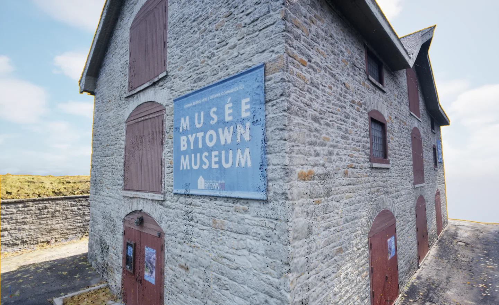
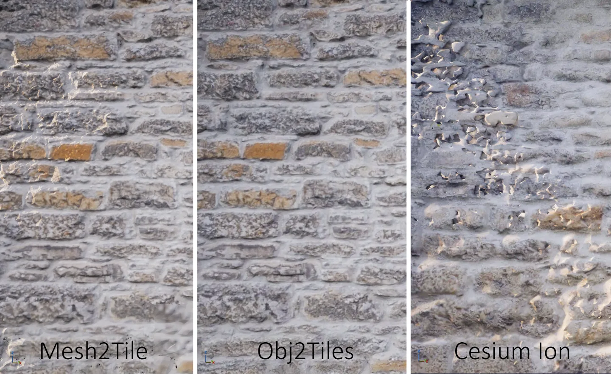

<h1 align="center">mesh2tile</h1>

<p align="center"><b>Turn photogrammetry into streamable 3D Tiles, on your own machine.</b><br>A command-line tool that converts textured OBJ meshes into 3D Tiles with Blender,<br>ready for Cesium for Unreal and CesiumJS.</p>

<p align="center">
  <a href="https://github.com/ArkounM/mesh2Tile/releases/latest"></a>
  <a href="#install"></a>
  <a href="#install"></a>
  <a href="#what-it-does"></a>
  <a href="LICENSE"></a>
  <a href="https://doi.org/10.5194/isprs-archives-XLIX-B2-2026-485-2026"></a>
</p>

<p align="center">
  <a href="#quick-start"></a>
  &nbsp;
  <a href="#benchmarks"></a>
  &nbsp;
  <a href="https://doi.org/10.5194/isprs-archives-XLIX-B2-2026-485-2026"></a>
</p>

<p align="center">
  <a href="#quick-start">Quick start</a> ·
  <a href="#gallery">Gallery</a> ·
  <a href="#what-it-does">What it does</a> ·
  <a href="#install">Install</a> ·
  <a href="#options">Options</a> ·
  <a href="#benchmarks">Benchmarks</a> ·
  <a href="#compatibility">Compatibility</a> ·
  <a href="#limits">Limits</a> ·
  <a href="#citation">Citation</a> ·
  <a href="#contributing">Contributing</a>
</p>

<p align="center">
  
</p>

<p align="center"><sub>The Bytown Museum's Commissariat Building, converted by mesh2tile and streamed in Cesium for Unreal.</sub></p>

---

Point mesh2tile at a folder of OBJ files and it builds a 3D Tiles tileset you can stream into
Cesium for Unreal or CesiumJS. Blender splits the model into an adaptive octree of balanced tiles,
bakes a texture for each tile and exports GLB, and 3d-tiles-tools writes the tileset. It handled a
90-million-triangle model that Cesium Ion could not process. Your data never leaves your machine.

## Quick start

```bash
git clone https://github.com/ArkounM/mesh2Tile.git
cd mesh2Tile
pip install -e .
```

Then:

```bash
mesh2tile -i path/to/obj_folder -o path/to/output --longitude -75.7 --latitude 45.4 --height 77.5
```

That's it. The tileset is in `path/to/output/<model name>/tileset.json`. You also need
[Blender 4.4+](https://www.blender.org/download/) (found on your PATH or in its standard install
location, or pass `--blender-path`) and [Node.js 18+](https://nodejs.org/), which fetches
3d-tiles-tools on first use.

## Gallery

<table>
  <tr>
    <td width="50%"></td>
    <td width="50%"></td>
  </tr>
  <tr>
    <td><sub><b>Streamed in Unreal</b>: the 3D Tiles output in Cesium for Unreal.</sub></td>
    <td><sub><b>Up close</b>: the same wall from mesh2tile, Obj2Tiles and Cesium Ion.</sub></td>
  </tr>
</table>

## What it does

| | What you get | How you use it |
|---|---|---|
| **Adaptive octree tiling** | Tiles split by geometry density, so dense areas get smaller tiles and every tile stays near its triangle budget. | Automatic. `--triangle-threshold`, `--lods` |
| **Per-tile texture baking** | Each tile gets its own baked texture, sized to the tile, instead of carrying the full source texture. | Automatic. `--texture-max-size`, `--bake-samples` |
| **Parallel processing** | Several Blender instances bake and convert tiles at once. | `--max-bake-workers`, `--max-conversion-workers`, `--parallel-tiling` |
| **Large models** | Models above 20M faces are split on disk before Blender opens them, so each chunk fits in memory. | Automatic. `--presplit-threshold` |
| **Batch processing** | Convert a whole folder of OBJs in one run. | `--continue-on-error` |
| **Georeferencing** | The model's origin placed on the globe. | `--longitude`, `--latitude`, `--height` |
| **Saved settings** | Keep your options in a JSON file and reuse them. | `--save-config`, `--config` |
| **Gzip** | Optional gzip of the finished tileset. | `--gzip` |

## Install

| | How | Needs |
|---|---|---|
| **pip** | `git clone`, then `pip install -e .` in the repository. | Python 3.9+, Blender 4.4+, Node.js 18+ |

Check the install with `mesh2tile --version`.

## Options

| Option | What it does | Default |
|---|---|---|
| `-i`, `--input` | Folder of OBJ files (required) | |
| `-o`, `--output` | Output folder (required) | |
| `-l`, `--lods` | Number of LOD levels | 3 |
| `--triangle-threshold` | Triangles per tile | 20000 |
| `--texture-max-size` | Largest baked texture, in pixels | 1024 |
| `--bake-samples` | Cycles bake samples | 128 |
| `--gzip` | Gzip the output | off |
| `--max-bake-workers` | Parallel Blender instances for baking | CPU/2, max 8 |
| `--max-conversion-workers` | Parallel workers for GLB conversion | CPU/2, max 8 |
| `--batch-bake` | Bake each LOD in a single Blender session | off |
| `--parallel-tiling` | Tile the first-level chunks in parallel | off |
| `--max-tiling-workers` | Parallel workers for tiling | 4 |
| `--presplit-threshold` | Face count above which the OBJ is split on disk first; 0 turns it off | 20M |
| `--longitude`, `--latitude`, `--height` | Where the model's origin goes (degrees, degrees, metres) | 0, 0, 0 |
| `--blender-path` | Blender executable, instead of auto-detection | |
| `--config` | Load options from a JSON file | |
| `--save-config` | Write the resolved options to a JSON file and exit | |
| `--temp` | Keep the intermediate files | off |
| `--force` | Overwrite an existing output folder | off |
| `--continue-on-error` | Keep going when one file fails | off |

Options given on the command line override the config file:

```bash
mesh2tile -i input/ -o output/ --triangle-threshold 50000 --save-config my_settings.json
mesh2tile -i input/ -o output/ --config my_settings.json
```

## Benchmarks

The Bytown Commissariat Building (16K source texture) at three sizes, against Obj2Tiles and Cesium
Ion. Measured on an i9-14900F, RTX 4080 SUPER and 64 GB of RAM; Cesium Ion's time is its
cloud-side upload and conversion.

| | mesh2tile 2.1 | Obj2Tiles 1.0.13 | Cesium Ion |
|---|---|---|---|
| 900K triangles | 223 MB, 168 tiles, 192 s | 195 MB, 48 tiles, 253 s | 71.5 MB, 336 tiles, ~183 s |
| 9M triangles | 671 MB, 372 tiles, **14 min** | 580 MB, 48 tiles, 46 min | 108.7 MB, 663 tiles, ~4 min |
| 90M triangles | **3,039 MB, 1,817 tiles, 2.9 h** | not tested | failed |

- **Balanced tiles.** On the 9M model the largest mesh2tile tile has 139K triangles, against 1.4M
  for Obj2Tiles, and the spread of tile sizes is 38 times tighter.
- **3.3 times faster than Obj2Tiles** on the 9M model.
- **The only tool that finished the 90M model**, split into 11 chunks that each stayed under 20 GB.
  Cesium Ion failed after 29 minutes.
- **Cesium Ion's output is smaller**: it compresses textures (KTX2) and geometry (Draco).

Full method and results are in the [paper](https://doi.org/10.5194/isprs-archives-XLIX-B2-2026-485-2026).

## Compatibility

- **Platforms**: Windows. Linux and macOS are untested.
- **Input**: textured OBJ. Tested with Metashape and RealityCapture exports.
- **Output**: a `tileset.json` and one GLB per tile.
- **Viewers**: Cesium for Unreal and CesiumJS.
- **Third-party**: [Blender](https://www.blender.org/) and
  [3d-tiles-tools](https://github.com/CesiumGS/3d-tiles-tools).

## Limits

- **Baked textures can show dark specks or flat colour**, most on the coarse tiles near the root,
  where bake rays miss.
- **Coarse levels can look warped**: Blender's Decimate modifier distorts photogrammetry at the
  lowest LODs.
- **Output is larger than Cesium Ion's**: textures and geometry are not compressed.
- **Large models take hours**: the 90M model took 2.9 h with pre-splitting.

<details>
<summary><b>Troubleshooting</b></summary>

- **"Blender not found"**: put Blender on your PATH, or pass `--blender-path`.
- **Out of memory during baking**: lower `--max-bake-workers` to 1 or 2.
- **GLB files are empty or broken**: check Blender is 4.4 or newer and the OBJ has UVs and a texture.
- **The run hangs during conversion**: lower `--max-conversion-workers`.

</details>

<details>
<summary><b>Repository structure</b></summary>

```
mesh2Tile/
├── mesh2tile/
│   ├── cli.py                # Command line
│   ├── config.py             # Defaults and config file loading
│   ├── core.py               # Runs one model
│   ├── blender.py            # Blender detection
│   ├── BlenderScripts/       # Tiling, baking and GLB export inside Blender
│   └── pipeline/             # Pre-splitting, Blender calls, tileset.json, gzip
├── mesh2tile.py              # Entry point
└── RhinoScripts/             # FBX to OBJ helper
```

</details>

## Citation

mesh2tile was introduced in:

> Merchant, A., Weigert, A., Dennis, C., and Fai, S.: An Open-Source Pipeline for Runtime-Optimized
> Heritage Photogrammetry in Game Engines, Int. Arch. Photogramm. Remote Sens. Spatial Inf. Sci.,
> XLIX-B2-2026, 485, https://doi.org/10.5194/isprs-archives-XLIX-B2-2026-485-2026, 2026.

```bibtex
@article{merchant2026mesh2tile,
  author  = {Merchant, Arkoun and Weigert, Adam and Dennis, Chloe and Fai, Stephen},
  title   = {An Open-Source Pipeline for Runtime-Optimized Heritage Photogrammetry in Game Engines},
  journal = {The International Archives of the Photogrammetry, Remote Sensing and Spatial Information Sciences},
  volume  = {XLIX-B2-2026},
  pages   = {485},
  year    = {2026},
  doi     = {10.5194/isprs-archives-XLIX-B2-2026-485-2026}
}
```

## Contributing

Bug reports, ideas and pull requests are welcome. Open an
[issue](https://github.com/ArkounM/mesh2Tile/issues) with your platform, the tool that exported
the model, and the command you ran.

## License

[MIT](LICENSE). Third-party tools keep their own licenses.

The Bytown Commissariat Building model is shown courtesy of the Bytown Museum.
